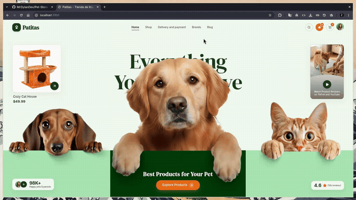

# Patitas — Hero de tienda para mascotas

Patitas es una interfaz responsive de una tienda de productos premium para mascotas. El proyecto está construido con React, TypeScript, Vite y Tailwind CSS, y se centra en una experiencia de compra visual con hero adaptable, catálogo, favoritos, carrito y ventanas modales.

## Inicio rápido

Necesitas tener instalado:

- [Node.js](https://nodejs.org/) 20 o superior
- npm

Desde la carpeta del proyecto, ejecuta:

```bash
npm install
npm run dev
```

Después abre [http://localhost:3000](http://localhost:3000).

## Qué incluye

- Hero independiente para escritorio, tablet y móvil.
- Navegación principal con acceso a búsqueda, favoritos y carrito.
- Catálogo de productos destacados con categorías, precios, calificaciones y disponibilidad.
- Búsqueda de productos.
- Detalle de producto con opción para agregar al carrito o guardar en favoritos.
- Carrito con actualización de cantidades, eliminación de artículos y cálculo del total.
- Modal de favoritos.
- Modal de reseñas de la comunidad.
- Modal de video y catálogo exploratorio.
- Diseño visual basado en Tailwind CSS y componentes reutilizables.

> **Nota:** Es una demo de frontend. El carrito y los favoritos viven en el estado de React, por lo que se reinician al recargar la página. No hay autenticación, base de datos, pagos ni backend conectado.

## Comandos disponibles

| Comando | Uso |
| --- | --- |
| `npm install` | Instala las dependencias en `node_modules/`. |
| `npm run dev` | Inicia el servidor de desarrollo en el puerto `3000`. |
| `npm run build` | Genera la compilación de producción en `dist/`. |
| `npm run preview` | Sirve localmente la compilación de producción. |
| `npm run lint` | Comprueba los tipos de TypeScript sin generar archivos. |
| `npm run clean` | Elimina `dist/` y `server.js`. |

Para validar una compilación antes de publicarla:

```bash
npm run lint
npm run build
```

## Estructura del proyecto

```text
.
├── index.html                  # Documento HTML y metadatos de la página
├── docs/
│   └── assets/
│       └── video.mp4           # Video de referencia reproducible desde este README
├── package.json                # Scripts y dependencias
├── vite.config.ts              # Configuración de Vite, React y Tailwind
├── src/
│   ├── App.tsx                 # Estado global de la demo y composición principal
│   ├── main.tsx                # Punto de entrada de React
│   ├── index.css               # Estilos globales
│   ├── data/
│   │   └── constants.ts        # Productos, imágenes y datos iniciales
│   └── components/
│       ├── Header.tsx
│       ├── DesktopHero.tsx
│       ├── TabletHero.tsx
│       ├── MobileHero.tsx
│       └── *Modal.tsx           # Modales de búsqueda, catálogo, carrito, etc.
└── .env.example                # Plantilla de variables de entorno
```

## Configuración

Las imágenes de la demo están referenciadas mediante URLs externas en [`src/data/constants.ts`](./src/data/constants.ts).

El archivo `.env.example` contiene variables previstas para integraciones futuras con Gemini y despliegues gestionados. La interfaz actual no necesita una clave de API para ejecutarse localmente.

Si necesitas preparar un archivo local de entorno:

```bash
cp .env.example .env.local
```

No subas `.env.local` ni claves privadas al repositorio.

## Video de referencia

El video original de `Downloads` está incluido únicamente como documentación del proyecto. No se utiliza en la aplicación ni se copia a `src/` o a `public/`.



> 📹 **Video completo:** Podés ver o descargar la grabación original en alta definición desde [`docs/assets/video.mp4`](./docs/assets/video.mp4).

## Desarrollo

Para agregar o editar productos, modifica `FEATURED_PRODUCTS` en [`src/data/constants.ts`](./src/data/constants.ts). Cada producto implementa la interfaz `ProductItem`, que define su identificador, nombre, precio, imagen, categoría, descripción, calificación y disponibilidad.

La lógica compartida de la demo está en [`src/App.tsx`](./src/App.tsx). Los componentes visuales y los modales están separados dentro de [`src/components/`](./src/components/).

## Tecnologías

- React 19
- TypeScript
- Vite
- Tailwind CSS 4
- `lucide-react` para iconos
